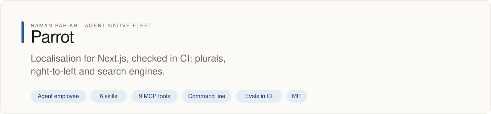
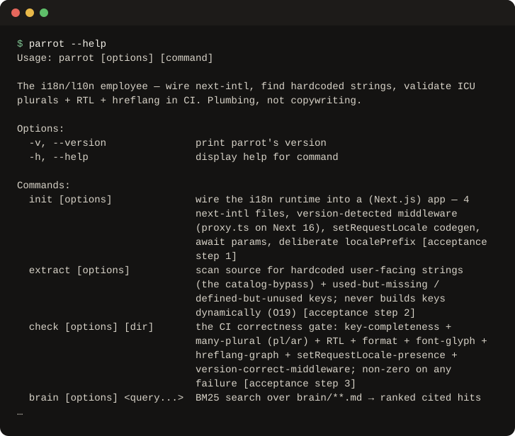

# parrot

<!-- fleet:header:start -->
<p align="center"><picture><source media="(prefers-color-scheme: dark)" srcset="assets/banner-dark.svg"></picture></p>

<p align="center">
<a href="https://github.com/naman10parikh/parrot/actions/workflows/ci.yml"></a>
<a href="https://github.com/naman10parikh/parrot/releases"></a>
<a href="LICENSE"></a>
<a href="#use-it-from-any-coding-agent"></a>
<a href="https://x.com/naman10parikh"></a>
<a href="https://www.linkedin.com/in/naman-parikh1/"></a>
</p>

<p align="center"><a href="#quick-start">Quick start</a> · <a href="docs/README.md">How it works</a> · <a href="AGENTS.md">AGENTS.md</a> · <a href="llms.txt">llms.txt</a> · <a href="skills/">Skills</a> · <a href="https://github.com/naman10parikh/parrot/discussions">Discussions</a> · <a href="https://github.com/naman10parikh">All projects</a></p>

**Localisation for Next.js, checked in CI: plurals, right-to-left and search engines.**

Parrot is an agent employee, a packaged specialist agent with its own skills, memory and tests. It owns one job: localisation. Coding agents use it through its skills, its MCP server and its command line. Its evals gate every merge in CI. A person makes every change.

_Parrot is part of an agent-native play for agent-native systems that can eventually be recursively self-improving and evolving, operated by agent employees._

<p align="center"></p>
<!-- fleet:header:end -->

Parrot is for teams that ship a Next.js app in more than one language. It wires next-intl correctly the first time,
finds user-facing strings that skip the message catalog, and checks the bugs English never shows: a wrong plural in
Polish or Arabic, a layout that breaks right to left, and a broken hreflang graph that hides pages from search. It
carries and checks the strings; it never writes the copy.

<!-- fleet:use:start -->
## Use it from any coding agent

**Claude Code**: the plugin brings the skills, sub-agents, hooks and MCP server.

```
/plugin marketplace add naman10parikh/parrot
/plugin install parrot@parrot
```

<details><summary>Its MCP server, Codex, Cursor, Gemini CLI, one skill and the command line</summary>

**Its MCP server**, in any MCP client:

```bash
claude mcp add --transport stdio parrot -- npx -y -p github:naman10parikh/parrot parrot-mcp
codex mcp add parrot -- npx -y -p github:naman10parikh/parrot parrot-mcp
```

Cursor (`.cursor/mcp.json`), Gemini CLI (`.gemini/settings.json`) and most other clients take the same command as JSON:

```json
{
  "mcpServers": {
    "parrot": {
      "command": "npx",
      "args": [
        "-y",
        "-p",
        "github:naman10parikh/parrot",
        "parrot-mcp"
      ]
    }
  }
}
```

**Gemini CLI**: the extension brings the context and the MCP server.

```bash
gemini extensions install https://github.com/naman10parikh/parrot
```

**One skill** (6 in all, in [skills/](skills/)), in any agent that reads Agent Skills:

```bash
gemini skills install https://github.com/naman10parikh/parrot --path skills/i18n-setup-nextjs
git clone --depth 1 https://github.com/naman10parikh/parrot /tmp/parrot && cp -r /tmp/parrot/skills/i18n-setup-nextjs ~/.claude/skills/
```

**The command line:**

```bash
npx -y -p github:naman10parikh/parrot parrot --help
```

</details>

Codex, Cursor, OpenCode, GitHub Copilot and other agents read [AGENTS.md](AGENTS.md); Claude Code reads [CLAUDE.md](CLAUDE.md) and Gemini CLI reads [GEMINI.md](GEMINI.md), which import it. [llms.txt](llms.txt) maps every surface for agents that read first.
<!-- fleet:use:end -->

## Quick start

```bash
git clone https://github.com/naman10parikh/parrot && cd parrot
pnpm install && pnpm build
node bin/parrot extract --dir eval/fixtures/app                    # finds the planted hardcoded string (exits 1 by design)
node bin/parrot check --dir eval/fixtures/app --locales en,pl,ar   # catches the planted Polish plural gap (exits 1 by design)
node bin/parrot brain "setRequestLocale static rendering"          # ranked, cited hits from the brain
pnpm test && pnpm eval                                             # unit tests and the eval gate
```

`extract` and `check` are linters: they exit non-zero when they find a problem, so the fixture's planted bugs make
them fail on purpose. Add `--json` for agents. None of these needs an account or a key.

## How it works

- **Plumbing, not authoring.** Every task is placed on one line first. Wiring the pipeline that carries and checks
  the strings is parrot's job. Writing the copy, choosing the brand voice or translating prose belongs to a person
  or a content employee, and parrot hands it off.
- **Test the part English hides.** Every correctness claim is tested in a language with many plural forms (Polish,
  Arabic) and in a right-to-left language (Arabic, Hebrew), never in English alone.
- **One gate for CI.** `parrot check` covers key completeness, plurals, right-to-left markup, formats, hreflang
  codes, `setRequestLocale` in static pages and the middleware file for the Next.js version. It exits non-zero on
  any failure.
- **The brain is the asset.** Six files in `brain/` hold the twelve jobs, 16 real scenarios, 29 pitfalls, 25
  opinions, the open disputes and the tool matrix. `parrot brain` and the MCP server search them.
- **A hook that obeys its own rule.** In this repository, the `i18n-string-gate` hook blocks an edit that adds a
  hardcoded user-facing string to a `.tsx` or `.jsx` file.

<!-- fleet:anatomy:start -->
## What it is made of

Every project in this fleet is graded on the same 11 harness components and on self-improvement. Each mark is backed by a file you can open.

| Component | Grade | Where |
| --- | --- | --- |
| Identity | ✅ | identity/SOUL.md:1 identity/BRAND.md:3 |
| Memory | ✅ | memory/MEMORY.md:1 scripts/brain-search.mjs:1 memory/LEARNINGS.md:5 |
| Skills | ✅ | skills/i18n-setup-nextjs/SKILL.md:1 skills/rtl-bidi-audit/SKILL.md:1 |
| Tools/CLIs | ✅ | package.json:7 bin/parrot:1 src/cli/index.ts:1 |
| Hooks | ✅ | .claude/settings.json:10 .claude/hooks/i18n-string-gate.js:1 .claude/hooks/package.json:2 hooks/hooks.json:8 |
| Sub-agents | ✅ | .claude/agents/i18n-correctness-auditor.md:2 .claude/agents/i18n-migration-planner.md:2 |
| MCPs | ✅ | src/mcp/server.ts:1 package.json:8 .mcp.json:3 |
| Dispatch | ✅ | src/dispatch/route.ts:169 .github/workflows/rsi.yml:10 |
| Evals | ✅ | eval/eval.mjs:1 .github/workflows/acceptance.yml:53 |
| Observability | ✅ | src/lib/logger.ts:44 scripts/runs-view.mjs:1 |
| Sandbox/Infra | ✅ | sandbox/boot.mjs:1 .github/workflows/ci.yml:114 sandbox/render-ar.mjs:1 |
| Self-improvement | ✅ | dsip.json:1 workflows/rsi.workflow.js:1 .github/workflows/rsi.yml:10 |

✅ real and tested · 🟡 partial, with the reason in the row · ❌ absent
<!-- fleet:anatomy:end -->

<!-- fleet:footer:start -->
## How it improves itself

It carries its own evals and a self-improvement contract, [`dsip.json`](dsip.json), which says what it may change and how a change is judged. Its evals gate every merge in CI. A person makes every change. Lessons it learns are kept as rules in its memory files.

## Part of a fleet

One of the projects by [Naman Parikh](https://github.com/naman10parikh). Each owns one part of an agent's harness, or of the product around an agent, and all of them follow one standard.

| Related project | What it owns |
| --- | --- |
| [AgentDial](https://github.com/naman10parikh/agentdial) | Identity |
| [WikiMem](https://github.com/naman10parikh/wikimem) | Memory |
| [Skillsmith](https://github.com/naman10parikh/skillsmith) | Skills |
| [Agent Booster](https://github.com/naman10parikh/agent-booster) | Tools / CLIs |
| [Armory](https://github.com/naman10parikh/armory) | MCPs and the component registry |
| [AgentGrid](https://github.com/naman10parikh/agentgrid) | Dispatch |
| [AgentSwarm](https://github.com/naman10parikh/agentswarm) | Dispatch |
| [AgentBench](https://github.com/naman10parikh/agentbench) | Evals |
| [AgentMoney](https://github.com/naman10parikh/agentmoney) | Observability |
| [Claude Harness](https://github.com/naman10parikh/claude-harness) | The whole harness, as a template |

## Community

Questions and ideas go to [Discussions](https://github.com/naman10parikh/parrot/discussions); bugs go to [issues](https://github.com/naman10parikh/parrot/issues/new/choose). Follow the work on [X](https://x.com/naman10parikh) and [LinkedIn](https://www.linkedin.com/in/naman-parikh1/).

## Contributing and security

Read [CONTRIBUTING.md](CONTRIBUTING.md). AI-assisted pull requests are welcome. Report a vulnerability privately, as [SECURITY.md](SECURITY.md) explains.

## License

MIT, © 2026 Naman Parikh. See [LICENSE](LICENSE) and [NOTICE](NOTICE).
<!-- fleet:footer:end -->
