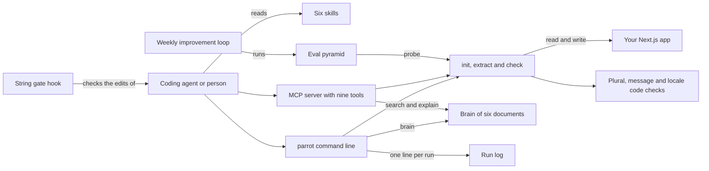

# How Parrot works

Parrot is for teams that ship a Next.js app in more than one language. It wires next-intl, a translation library for Next.js, correctly the first time. It finds user-facing strings that skip the message catalog, the file of translated messages per language. It also checks the bugs English never shows: a wrong plural in Polish or Arabic, a right-to-left layout and a broken hreflang graph. Hreflang tags tell search engines which page serves which language. Parrot carries and checks the strings. It never writes the copy.

## The parts



An agent reaches Parrot through its [skills](../skills/), its command line or its MCP server. MCP (Model Context Protocol) is a standard way for an agent to call tools. [bin/parrot](../bin/parrot) runs the command line in [src/cli/index.ts](../src/cli/index.ts). The three working commands live in [src/cli/commands/](../src/cli/commands/). The MCP server in [src/mcp/server.ts](../src/mcp/server.ts) wraps the same functions as nine tools over stdio, and serves the brain files as resources.

The shared checks live in [src/lib/](../src/lib/). [src/lib/plural.ts](../src/lib/plural.ts) asks the built-in `Intl.PluralRules` which plural forms a language needs. [src/lib/icu-parse.ts](../src/lib/icu-parse.ts) reads ICU messages, the standard format for plurals and choices inside a message. [src/lib/bcp47.ts](../src/lib/bcp47.ts) validates language codes. [src/lib/hardcoded-heuristic.ts](../src/lib/hardcoded-heuristic.ts) spots user-facing text outside the catalog. [src/lib/logger.ts](../src/lib/logger.ts) appends one line per run to a log in [logs/](../logs/). The hook in [.claude/hooks/i18n-string-gate.js](../.claude/hooks/i18n-string-gate.js) blocks an edit that adds a hardcoded string to a `.tsx` or `.jsx` file.

## What happens when you run it

The main flow is the acceptance path in [.github/workflows/acceptance.yml](../.github/workflows/acceptance.yml): init, then extract, then check.

1. `parrot init --dir ./app --locales en,pl,ar` runs [src/cli/commands/init.ts](../src/cli/commands/init.ts). It reads the Next.js version from the app's `package.json`.
2. Init writes the routing file, the request config, the locale layout, a starter page and one message file per language. The routing file is named `proxy.ts` on Next.js 16 and later, and `middleware.ts` before that.
3. The generated layout calls `setRequestLocale` after `await params` and sets `<html lang dir>`. Init never overwrites a file that exists.
4. `parrot extract --dir ./app` runs [src/cli/commands/extract.ts](../src/cli/commands/extract.ts). It walks the source files and reports hardcoded strings, keys used but missing, and keys defined but unused. It exits 1 if it finds a hardcoded string.
5. `parrot check --dir ./app --locales en,pl,ar` runs [src/cli/commands/check.ts](../src/cli/commands/check.ts). It finds the message catalog and compares the keys across languages.
6. Check confirms each plural message covers every form the language needs, such as four in Polish. It also checks right-to-left markup, formats, hreflang codes, `setRequestLocale` and the middleware file name.
7. Check prints each failure with the brain entry it defends, or JSON with `--json`. It exits 1 on any failure, so it works as a CI gate.
8. Each command adds one line to the run log. The logger strips query strings and fragments from URLs first.

## Extending it

- **A command.** Add a `run` function in [src/cli/commands/](../src/cli/commands/), like [src/cli/commands/extract.ts](../src/cli/commands/extract.ts). Register it in `main` in [src/cli/index.ts](../src/cli/index.ts), and log it with `logRun`. Several commands are listed there as stubs, waiting for an implementation.
- **An MCP tool.** Add a tool definition and a handler in [src/mcp/server.ts](../src/mcp/server.ts) that calls the same function as the command. Cover it in [test/mcp-server.test.ts](../test/mcp-server.test.ts).
- **A skill.** Add `skills/<name>/SKILL.md`, following [skills/i18n-setup-nextjs/SKILL.md](../skills/i18n-setup-nextjs/SKILL.md).
- **An eval.** Add a golden task to [eval/golden/](../eval/golden/), shaped like [eval/golden/GT-01.json](../eval/golden/GT-01.json). Give it a brain scenario, an expected answer, `mustInclude` and `mustRefuse` words, and a `probe`. A new probe needs a case in `probeLeg` in [eval/eval.mjs](../eval/eval.mjs). Add its id to [eval/ci-blocking.json](../eval/ci-blocking.json) if it must block a merge.
- **Expertise.** Add to the matching document in [brain/](../brain/). `parrot brain "<query>"` searches it with BM25, a standard keyword ranking.

Then run `pnpm build && pnpm test && pnpm eval`. CI also runs the acceptance path three times and checks the result with [eval/acceptance/assert.mjs](../eval/acceptance/assert.mjs).

## Questions

**Does it need an API key or cost money?**
No. The command line, the MCP server, the tests and the evals need no account and no key. The top eval level, a model-graded judge, is not wired yet. It only reports whether a token is present and makes no call. The sandbox boot in [sandbox/boot.mjs](../sandbox/boot.mjs) uses `E2B_API_KEY` if set. Without it, the boot runs the same checks on your machine.

**Does any data leave the machine?**
Not from the command line or the MCP server, which read and write local files. The weekly loop runs `npm view` for the six packages it tracks. With `E2B_API_KEY` set, the sandbox boot copies the built tool and a test app into an E2B cloud microVM, a small virtual machine. The local page from `pnpm serve` serves on port 7799 by default.

**How does it improve itself?**
Its self-improvement contract, [dsip.json](../dsip.json), names one level, `agent`, an `on-signal` cadence and `noSelfGrading: true`. [.github/workflows/rsi.yml](../.github/workflows/rsi.yml) runs [workflows/rsi.workflow.js](../workflows/rsi.workflow.js) every Monday at 09:00 UTC. The loop compares six package versions on npm with the pins in the brain. Then it runs the structural evals. It writes a proposal to `.rsi/proposal.json`, which git ignores, and never commits. The workflow then fails if any tracked file changed.

**How do I run its tests or checks?**

```bash
pnpm install && pnpm build
pnpm test                          # unit tests, with vitest
pnpm eval                          # structural checks and the golden tasks
node bin/parrot eval --level 1     # structural checks only
pnpm test:e2e                      # the local page, with Playwright
```

**What does it not do?**
It never writes copy, picks a brand voice or translates prose. `parrot init` wires next-intl only. The command line lists `icu`, `rtl`, `fonts`, `seo`, `mt`, `tms`, `pick` and `explain`, but they print "not yet implemented" and exit 2. The MCP server does offer working tools for ICU messages, right-to-left audits, hreflang, library picks and brain entries. No machine translation or translation-service sync is exposed yet.
